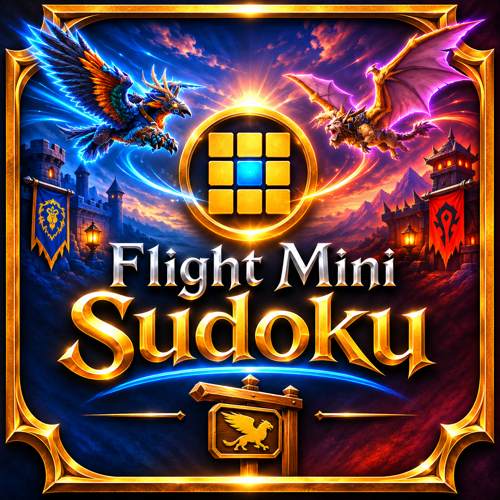
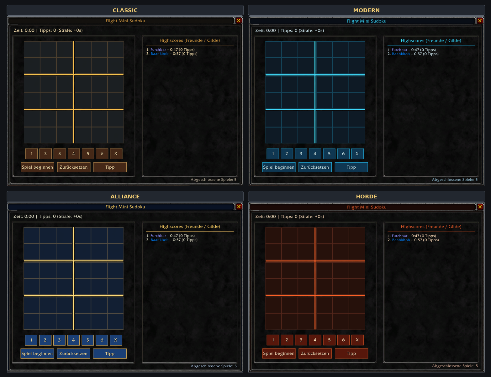
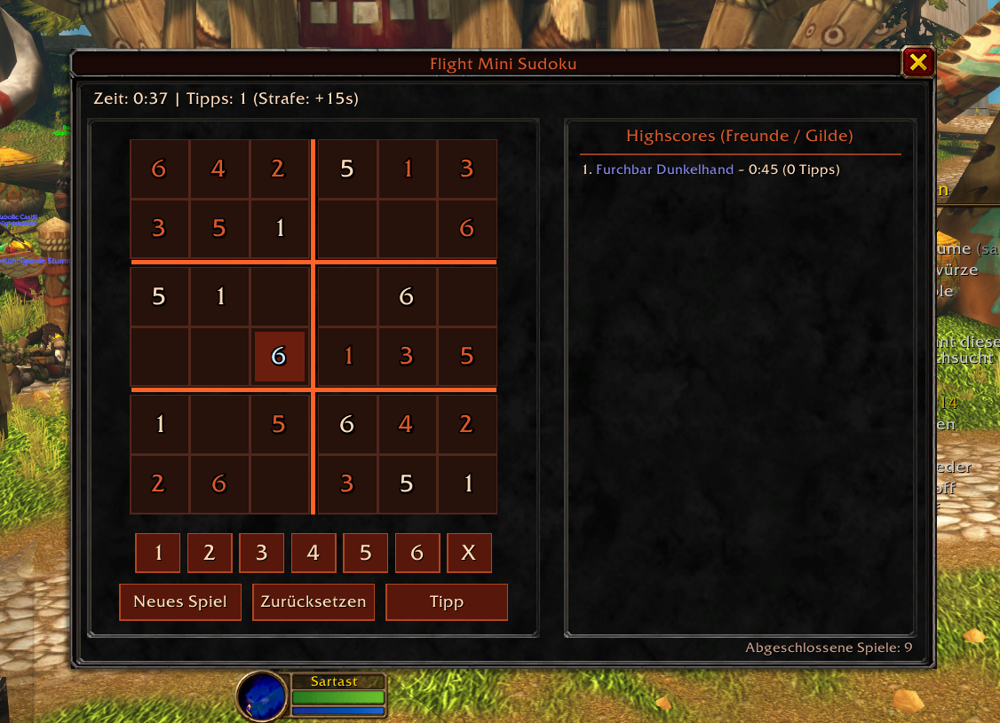
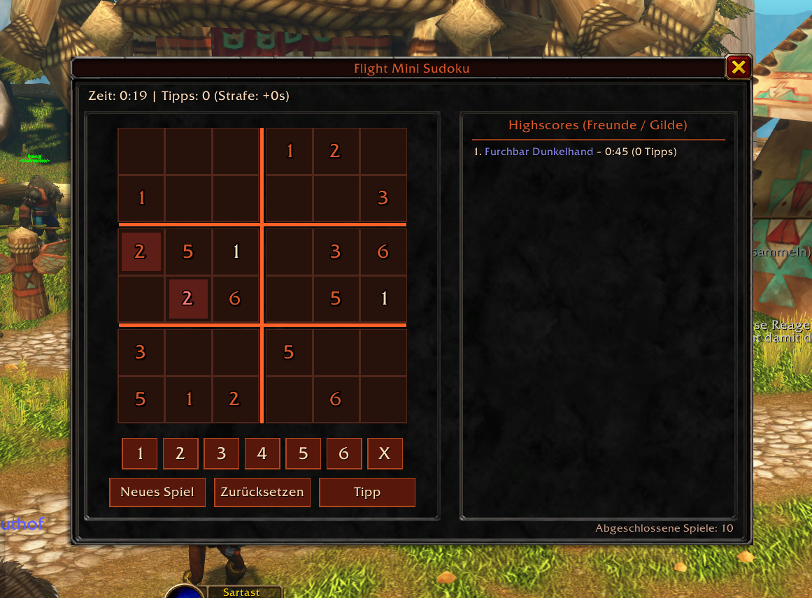
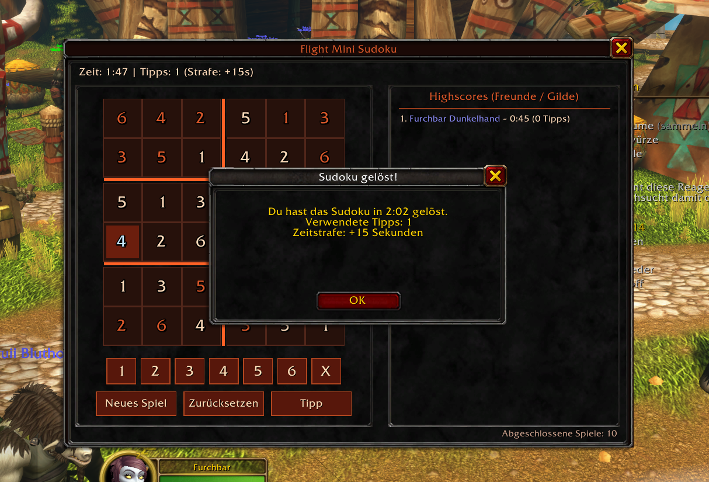

# Flight Mini Sudoku

  

  A compact 6x6 Sudoku addon for World of Warcraft. 
  Solve puzzles while waiting for flight paths and compete with friends and guild members!

  <a href="https://www.curseforge.com/wow/addons/flight-mini-sudoku">
    <strong>Get Flight Mini Sudoku on CurseForge</strong>
  </a>

## Screenshots

### Four UI Themes

Choose between four different interface designs. Every theme is available to every character, regardless of their in-game faction.

  

### Gameplay

  

  

  

## Description

Flight Mini Sudoku brings a small Sudoku puzzle directly into your World of Warcraft interface.

Solve 6x6 Sudoku puzzles with 2x3 blocks, track your completion times and compete with other players!

Customize the interface with four different visual themes to match your preferred style.

## Features

- **6x6 Sudoku:** Compact puzzles designed for short breaks between flights.
- **Four UI themes:** Choose between Classic, Modern, Alliance and Horde designs.
- **Character-specific themes:** Each character can select their own interface design, regardless of faction.
- **Timer and statistics:** Track your completion times and completed games.
- **Hints:** Get help when you're stuck, with a time penalty for each hint.
- **Top 20 leaderboard:** Compare your best times with friends and guild members.
- **Class-colored names:** Recognize other players by their WoW class colors.
- **Automatic synchronization:** Highscores are exchanged privately between online addon users on your friends list or in your guild.
- **Minimap button:** Quickly open the Sudoku interface.
- **Flight automation:** Optionally open the Sudoku automatically when starting a taxi flight.
- **German and English:** Automatically uses your game client's language.

## Installation

Install Flight Mini Sudoku directly through [CurseForge](https://www.curseforge.com/wow/addons/flight-mini-sudoku) or manually extract the `FlightMiniSudoku` folder into your game's `Interface/AddOns/` directory.

Make sure to download the version matching your WoW client.

## Compatibility

Separate downloads are provided for:

- **World of Warcraft Burning Crusade Classic**
- **World of Warcraft Forever**

Each version has its own interface compatibility settings and API adjustments.

## Highscore Synchronization

Highscore synchronization requires other players to have a compatible version of Flight Mini Sudoku installed.

- Only players on your friends list or in your guild are included.
- Highscores are exchanged automatically in the background.
- Addon messages use WoW's addon communication channel.
- No regular chat messages are sent.
- The leaderboard displays the top 20 results, including class-colored player names.

## UI Themes

Flight Mini Sudoku includes four selectable interface themes:

- **Classic:** The traditional fantasy-inspired interface.
- **Modern:** A clean, modern design with blue and cyan accents.
- **Alliance:** An Alliance-inspired blue and gold color scheme.
- **Horde:** A Horde-inspired red and dark metal color scheme.

All four themes are available to every player, regardless of their character's faction. Theme selection is saved individually per character.

## Localization

The addon automatically detects the client's language:

- German
- English

## License

Flight Mini Sudoku is released under the [MIT License](LICENSE).

You are free to use, modify and redistribute the addon under the terms of the MIT License.
